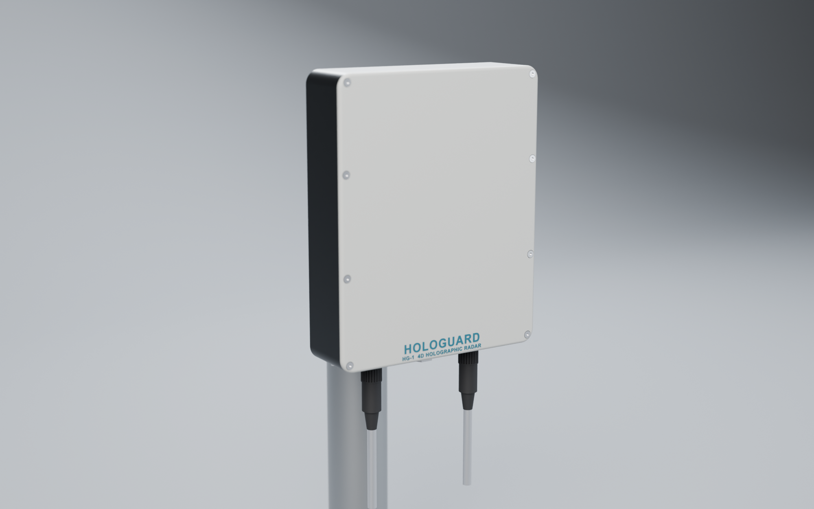

# HoloGuard HG-1: Ku-band GaN 4D holographic counter-UAS radar

A staring (holographic) 6 TX × 48 RX MIMO radar in the **same 163 × 203 × 57 mm envelope as the Echodyne EchoGuard**. It's lighter (1.06 kg vs 1.25 kg), uses less power (46.8 W vs 50 W), has longer range (Phantom 4: 1.5 km detect / 2.3 km spotlight track vs > 1 km) and better 3D accuracy (0.2° / 0.35° at 1 km vs 1° / 1.5°). Every beam is formed digitally from a 288-element virtual array, every CPI.



| Step | Documents | Sources / outputs |
|---|---|---|
| 1. High-level design | [docs/01_System_Design.md](docs/01_System_Design.md) | `hg1_params.py` (single source of truth), `analysis/` (link budget, trade study, figures) |
| 2. Board design + schematics | [docs/03_Board_Design.md](docs/03_Board_Design.md), [docs/05_Schematics.md](docs/05_Schematics.md) | `board/schematic/generate_schematics.py` → `board/kicad/*.kicad_sch` (ERC 0/0, parity clean); `board/generate_boards.py` → `*.kicad_pcb` (0 DRC errors), renders, `BOM_HG1.csv` |
| 3. Antenna design | [docs/02_Antenna.md](docs/02_Antenna.md), [docs/06_EM_Simulation.md](docs/06_EM_Simulation.md) | `antenna/array_design.py` → element CSV/JSON, beam patterns; `antenna/em/` → full-wave FEM (EMerge) of the element, scan-optimised on Modal |
| 4. Enclosure (FreeCAD) | [docs/04_Mechanical.md](docs/04_Mechanical.md) | `mech/build_enclosure.py` → `mech/out/HG1_enclosure.FCStd / .step / *.stl` |
| 5. Render (Blender) | [docs/04_Mechanical.md](docs/04_Mechanical.md) | `mech/render_blender.py` → `render/*.png`, `HG1_scene.blend` |
| 6. Firmware | [firmware/README.md](firmware/README.md) | Versal DSP chain + tracker (C++), STM32 housekeeping (C), simulator + verification |

## Regenerate everything

```bash
python analysis/system_budget.py
```

```bash
python antenna/array_design.py
```

```bash
"C:/Program Files/KiCad/10.0/bin/python.exe" board/generate_boards.py
```

```bash
sh board/render_boards.sh
```

```bash
"C:/Program Files/FreeCAD 1.1/bin/freecadcmd.exe" mech/build_enclosure.py
```

```bash
"C:/Program Files/Blender Foundation/Blender 5.2/blender.exe" -b --factory-startup -P mech/render_blender.py
```

```bash
cmd //c firmware\\build_host.bat
```

```bash
python firmware/sim/gen_scenario.py && firmware/build/hg1_radard.exe --input firmware/sim/out/scenario.iq --out firmware/sim/out && python firmware/sim/verify.py
```

## Honest status

This is a complete **design-stage** package:

- **Computed:** link budget, array and patterns.
- **Full-wave simulated:**
  - The radiating element has been simulated and optimised in an infinite-array FEM model to 60° azimuth / 40° elevation scan.
  - Its active |S11| is below −10 dB over 0.52–0.70 GHz around 16 GHz at every scan angle; see docs/06.
- **Schematics:** complete for all three boards, with ERC 0/0 and schematic↔PCB parity clean.
- **DRC-clean but unfinished:** board layouts are placed and RF-routed; the remaining digital/power routing is still to do.
- **Modelled:** enclosure and renders.
- **Verified in simulation:** the firmware, against independently synthesised raw ADC data.

Before hardware, it still needs:

- a finite-array and radome EM check, plus an independent-solver cross-check;
- the custom HRX-8 receiver RFIC (or a COTS brassboard);
- confirmation of Ku GaN PA availability;
- thermal CFD;
- the AIE/PL kernel implementation on the Versal.

Open risks are listed in docs/01 §10.
