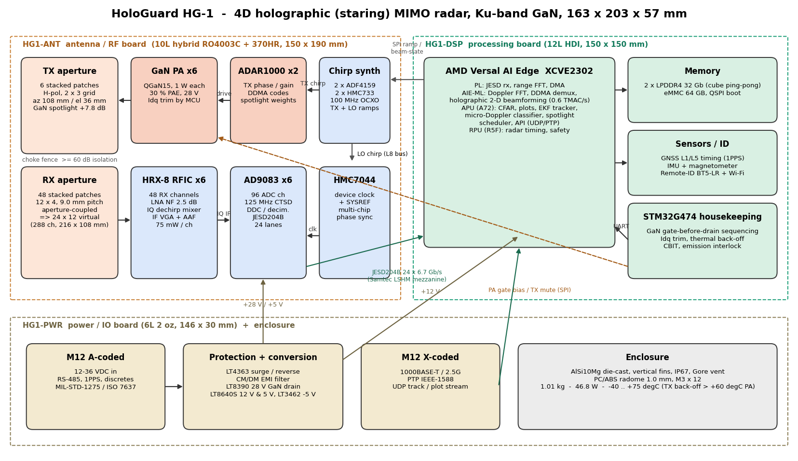
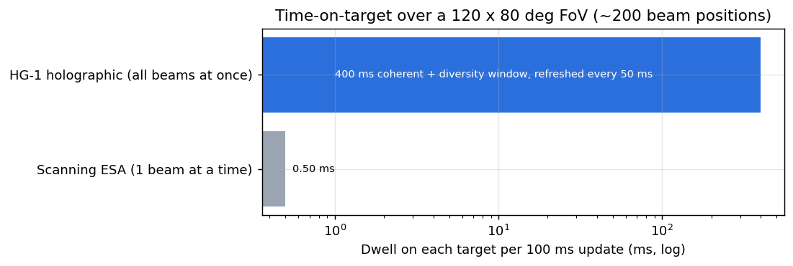
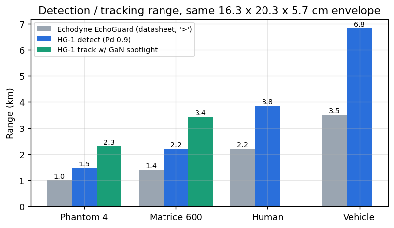
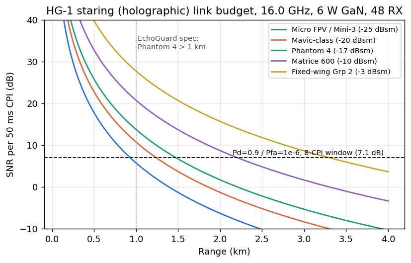
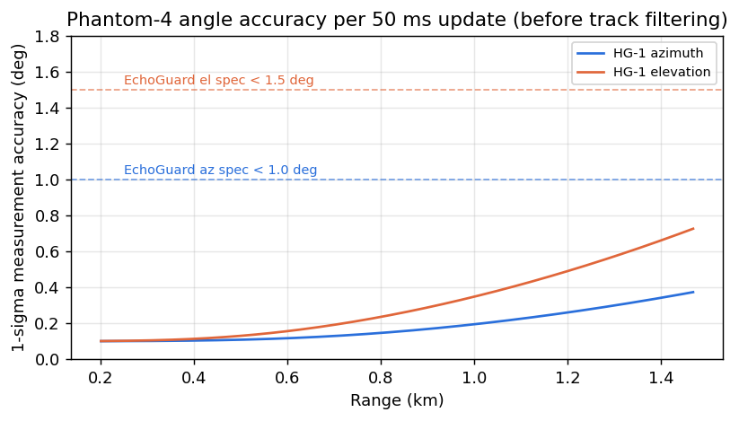
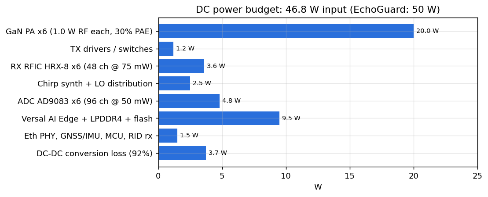

# HoloGuard HG-1: high-level system design

**A 4D "holographic" (staring) MIMO counter-UAS radar with GaN transmitters, in the same 16.3 × 20.3 × 5.7 cm envelope as the Echodyne EchoGuard.**

## 1. Concept: why "holographic" beats a scanning metamaterial array

Echodyne's EchoGuard uses a MESA (metamaterial electronically scanned array). It's a single-channel analogue beam that visits one direction at a time. With about 200 beam positions in a 120° × 80° field of view, each target gets well under 1 ms of dwell per 100 ms update.

HG-1 records the whole wavefront instead. Six GaN transmitters illuminate the entire volume at once with orthogonal (Doppler-division) waveforms. Forty-eight receivers digitise everything, and the processor reconstructs every beam, range and Doppler cell, every CPI. That's a digital hologram of the volume. This gives:

| Advantage | Consequence |
|---|---|
| **100 % time on target** (all beams at once) | Coherent 50 ms CPIs plus a 400 ms diversity window on every cell, so Phantom-class detection reaches 1.5 km (EchoGuard is rated > 1 km) at equal power |
| **Fine Doppler** (0.19 m/s) on every cell | Rotor micro-Doppler classification (drone vs bird) on every detection, not only on cued tracks |
| **No scan schedule** | Unlimited simultaneous tracks (limited only by compute; > 500 budgeted), 20 Hz updates, no revisit gaps on fast FPVs |
| **288-element digital co-array** | 3D angle on every plot; adaptive nulling of jammers is possible (a MESA has one RF channel and can't null) |
| **GaN spotlight** | On a confirmed threat the 6 TXs phase up coherently (+7.8 dB on target), extending track range to 2.3 km for a Phantom 4 |
| **Integrated Remote-ID receiver** | Cooperative drones are identified (BT5-LR and Wi-Fi beacons) and fused with radar tracks |

## 2. Specification vs Echodyne EchoGuard

EchoGuard figures are from Echodyne's public data sheet. HG-1 figures are computed in [`analysis/system_budget.py`](../analysis/system_budget.py) and the CAD model, and the firmware accuracy is verified in [`firmware/sim`](../firmware/sim).

| Parameter | Echodyne EchoGuard | **HoloGuard HG-1** | Basis |
|---|---|---|---|
| Size | 16.3 × 20.3 × 5.7 cm | **16.3 × 20.3 × 5.7 cm** | FreeCAD envelope |
| Mass | 1.25 kg | **1.06 kg** | CAD volume × density, +35 % PCB component adder |
| Power | 50 W | **46.8 W** | power budget |
| Band | K 24.45–24.65 GHz | **Ku 15.5–16.5 GHz** (500 MHz per mode) | trade study §3 |
| Architecture | MESA, 1 analogue beam | **6 TX × 48 RX MIMO, 288 virtual, fully digital** | |
| Field of view | 120° az × 80° el | **120° az × 80° el**, grating-lobe free to 90° | `antenna/array_design.py` |
| Phantom 4 (−17 dBsm) | > 1.0 km | **1.47 km** detect (Pd 0.9) / **1.69 km** (Pd 0.5) / **2.3 km** spotlight track | link budget |
| Matrice 600 (−10 dBsm) | > 1.4 km | **2.2 km** / 3.4 km spotlight | |
| Mavic (−20 dBsm) | – | **1.24 km** / 1.9 km spotlight | |
| Human / vehicle | > 2.2 km / > 3.5 km | **3.8 km / 6.8 km** (long-range mode) | |
| Angle accuracy | < 1.0° az × < 1.5° el | **0.19° × 0.35° at 1 km**, < 0.5° × 1.0° at max range per update | Cramér–Rao; sim measured 0.13–0.45° az |
| Range resolution | ~0.75 m (200 MHz) | **0.6 m** surveillance, 0.15 m zoom (1 GHz window) | |
| Velocity | – | **±58.5 m/s unambiguous**, 0.19 m/s resolution | empty-band DDMA |
| Update rate | 10 Hz | **20 Hz** (sliding window) | |
| Simultaneous tracks | 20 | **> 500** | compute-bound |
| Classification | track-based | **per-plot rotor micro-Doppler + RCS + kinematics** | firmware, verified |
| Counter-jamming | none (single channel) | 48-channel digital null steering (growth) | |
| Instrumented range | 6 km | 3 km surveillance / 7.5 km long-range mode | |
| Environment | IP67, −40…+75 °C | IP67, −40…+75 °C (TX back-off above +60 °C at the PA pedestal) | |
| Interfaces | GbE, 15–28 V | GbE / 2.5G (M12-X), PTP, **12–36 V** (M12-A), RS-485, 1PPS, GNSS | |

These are design-stage numbers. RCS values follow common practice for these classes (Phantom 4 at −17 dBsm), not a measured Ku-band signature.

## 3. Frequency and aperture trade

In a staring radar, sensitivity is set by **average power × receive aperture actually captured by digital channels × integration time**. Resolution is set by the virtual aperture. For a fixed channel budget (48 RX), each channel captures about λ²/4 of area, so lower frequency buys sensitivity and higher frequency buys resolution.

| Option | Sensitivity (48 RX, 6 W) | 3D resolution in the box | GaN maturity | Verdict |
|---|---|---|---|---|
| X-band 9.5 GHz | +4.7 dB | el beam ≥ 15° (box only 4.7 λ tall) | excellent (45 % PAE) | el accuracy too weak for 3D |
| **Ku-band 16 GHz** | reference | **5.8° × 11°** beams, 288 virtual | **good, COTS (Qorvo QGaN15)** | **selected** |
| K-band 24 GHz | −3.5 dB | 3.9° × 7° | no COTS GaN PA found at 24 GHz | needs custom MMIC |

Ku 15.5–16.5 GHz is the radiolocation band EchoShield already uses. 9.0 mm pitch is λ/2 at 16.5 GHz, so the array has no grating lobes anywhere in visible space.

## 4. Antenna (summary; details in [02_Antenna.md](02_Antenna.md))

- **6 TX** on a 2 × 3 grid (108 mm az, 36 mm el offsets) and **48 RX** on a 12 × 4 λ/2 grid. Their sum co-array is a filled **24 × 12 virtual array of 216 × 108 mm**, wider than the housing itself.
- **Elements:** aperture-coupled stacked patches, horizontally polarised. H-pol aligns with the horizontal rotor blades of multirotors, which maximises blade-flash micro-Doppler.
- A choke fence plus absorber between the TX and RX sub-apertures gives at least 60 dB isolation for FMCW.

## 5. Waveform: FMCW with Doppler-division MIMO

| Parameter | Surveillance | Long-range | Zoom (track) |
|---|---|---|---|
| Bandwidth / resolution | 250 MHz / 0.6 m | 50 MHz / 3 m | 1 GHz / 0.15 m (±150 m window, delayed-LO dechirp) |
| Ramp / PRI | 75 / 80 µs (12.5 kHz) | 75 / 80 µs | 75 / 80 µs |
| CPI / window | 50 ms / 8 CPIs (400 ms) | 100 ms / 4 | 50 ms |
| MIMO | DDMA, 6 TX + 2 empty sub-bands | same | spotlight (coherent TX) |
| Unambiguous velocity | ±58.5 m/s (full PRF, empty-band resolution) | same | same |
| Instrumented range | 3.0 km | 7.5 km | – |

The empty-band DDMA recovers the full-PRF velocity. In firmware, every detection also gets a coherent 8-hypothesis test over the full 288-element array, which rejects clutter residues that would otherwise alias into wrong sub-bands (see the firmware README).

## 6. Link budget

SNR per 50 ms CPI = Pt·Gt·N·Ge·λ²·σ·T / ((4π)³R⁴kT₀FL)

The inputs are:

- Pt = 6 W (6 × 1 W GaN)
- Ge = 5 dBi per element, N = 48 RX (21.5 dBi coherent)
- F = 2.8 dB
- L = 4.5 dB (radome 0.4, taper 1.3, straddle 1.5, atmosphere 0.3, misc 1.0)
- Detection: Pd 0.9, Pfa 1e-6, Swerling 2 over the 8-CPI frequency-hopped window, which needs **7.1 dB per CPI** (Shnidman)

| Target | RCS | Pd 0.9 | Pd 0.5 | Spotlight track |
|---|---|---|---|---|
| Micro FPV / Mini-3 | −25 dBsm | 0.93 km | 1.07 km | 1.45 km |
| Mavic | −20 dBsm | 1.24 km | 1.42 km | 1.93 km |
| **Phantom 4** | **−17 dBsm** | **1.47 km** | **1.69 km** | **2.30 km** |
| Matrice 600 | −10 dBsm | 2.20 km | 2.53 km | 3.44 km |
| Group-2 fixed wing | −3 dBsm | 3.28 km | 3.79 km | 5.14 km |

## 7. Processing and compute

- **Data rate:** 48 IQ channels at ~83 MS/s complex, about **128 Gb/s** over 24 JESD204B lanes.
- **Holographic beamforming:** 5,000 range × 625 Doppler cells × 512 beams every 50 ms, about **0.58 TMAC/s**. This runs on the AMD Versal AI Edge AIE-ML array; CFAR, tracking and classification run on the A72 APU.
- **Reference implementation and verification:** see [`firmware/`](../firmware/README.md).

## 8. Power, mass, thermal

| Mass item (CAD) | g |
|---|---|
| Housing (AlSi10Mg, finned) | 522 |
| Shield / heat-spreader frame | 118 |
| ANT PCB + copper + GNSS | 157 |
| DSP + PWR PCBs | 80 |
| PCB component adder (35 %) | 81 |
| Radome, screws, logo | 47 |
| Connectors, vent, fence, TIM | 55 |
| **Total** | **1,059** |

**Thermal.** 46.8 W leaves through 0.22 m² of finned housing. With natural convection plus radiation (h ≈ 9 W/m²K, anodised ε ≈ 0.85), the rise is about 25 K. The GaN PAs, RFICs and Versal conduct into the cast shield frame and back-wall pedestal. Full TX power is held to about +45 °C ambient. Above +60 °C at the PA pedestal, the MCU backs TX off linearly (≤ 3 dB, roughly −16 % range), and TX trips at +95 °C. This is the same practical behaviour a passively cooled 50 W EchoGuard-class unit has to accept at +75 °C, but it's managed explicitly.

## 9. Operating modes

1. **Holographic surveillance (default):** DDMA-MIMO staring over the full 120° × 80°.
2. **Spotlight:** time-interleaved coherent GaN beam on the top-threat track, +7.8 dB.
3. **Zoom ISAR:** 1 GHz delayed-LO window for 0.15 m imaging of a track (payload and shape).
4. **Long-range:** 50 MHz, 7.5 km, for vehicles, people and manned aircraft.
5. **Passive:** Remote-ID and RF-detect listening while TX is muted (EMCON).

## 10. Key risks and open items

| Risk | Mitigation |
|---|---|
| Custom HRX-8 SiGe RX RFIC (75 mW/ch) | Gen-0 brassboard with COTS LNA + IQ mixer per channel (HMC903-class; ~0.6 W/ch, 70 W unit) to validate algorithms while the RFIC is in fab |
| 1 W Ku GaN PA availability (TGA2958-SM is EOL) | Qorvo QGaN15 die-in-QFN or another 13–17 GHz GaN MMIC; TGA2218-SM (12 W) at reduced drain as fallback |
| ADAR1000 is specified to 16 GHz; band runs to 16.5 GHz | Characterise, or move TX phase coding into the custom RFIC companion (HTX) |
| DDMA blind speeds (Doppler near sub-band multiples) | PRI stagger between CPIs; clutter-map CFAR for hovering drones |
| Ku 15.5–15.7 GHz overlaps aeronautical radionavigation | Default 15.7–16.5 GHz civil profile; national frequency approval |
| FMCW TX/RX isolation ≥ 60 dB | Choke fence + absorber; EM verification needed; digital leakage canceller as backup |
| Full-wave EM not yet run | Element dimensions are analytic first cuts; HFSS/CST/openEMS unit-cell and embedded-pattern optimisation is the next step |

## Sources

- [Echodyne EchoGuard data sheet](https://www.echodyne.com/media/zixmcptm/ts-echoguard-echodyne_6ja.pdf) · [EchoShield data sheet](https://www.echodyne.com/media/nvufa2ud/echodyne-ts-echoshield.pdf)
- [Qorvo TGA2218-SM](https://www.qorvo.com/products/p/TGA2218-SM) · [Qorvo TGA2958-SM](https://www.qorvo.com/products/p/TGA2958-SM)
- [ADI AD9083](https://www.analog.com/en/products/ad9083.html) · [ADI HMC903](https://www-cce.cldnet.analog.com/media/en/technical-documentation/data-sheets/hmc903lp3e.pdf) · [ADI LTC5552](https://www.analog.com/en/products/ltc5552)
- [Staring / holographic radar principle (Aveillant)](https://www.defenceiq.com/defence-technology/articles/holographic-radar-to-counter-uas-attacks)
