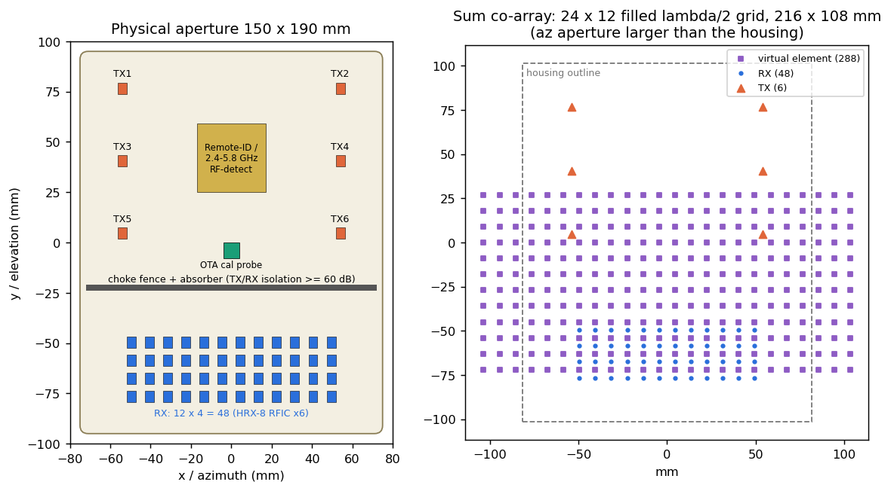
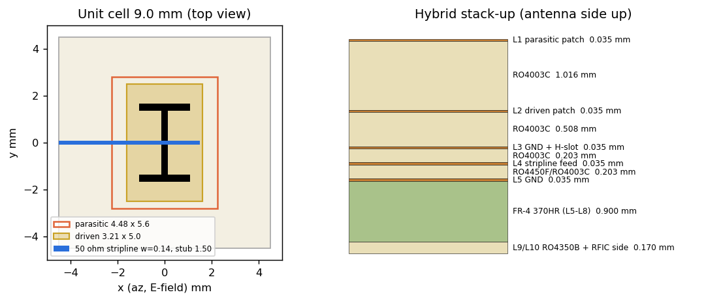
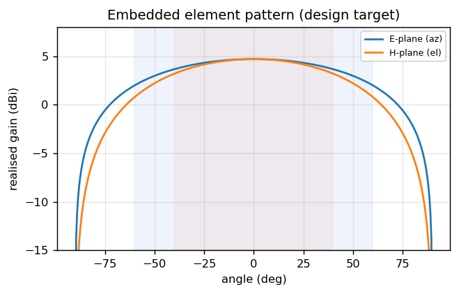
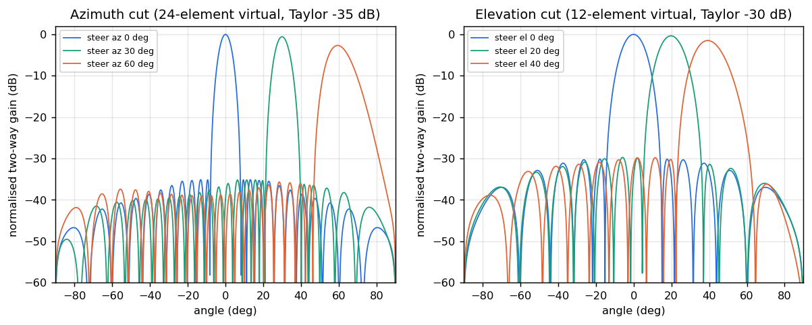
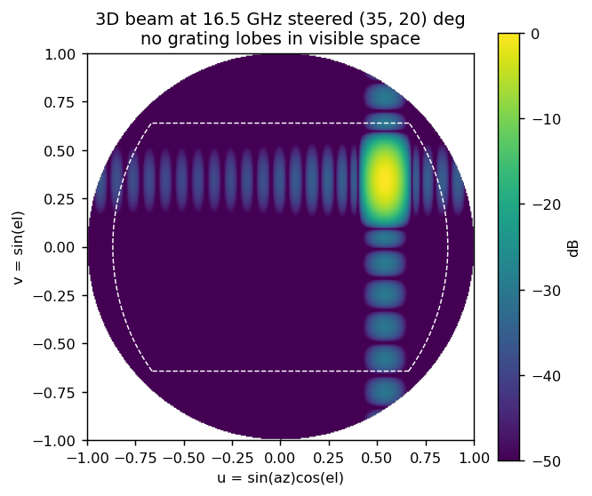
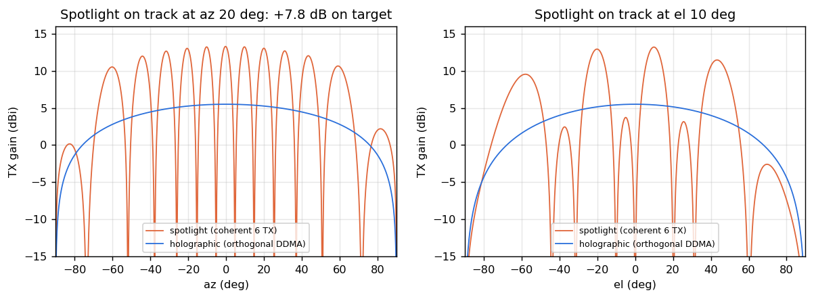

# HoloGuard HG-1: antenna design

Generated by [`antenna/array_design.py`](../antenna/array_design.py). Element coordinates are in [`antenna/element_positions.csv`](../antenna/element_positions.csv) and element geometry in [`antenna/element_design.json`](../antenna/element_design.json). The KiCad board and FreeCAD model are built from these same files.

## 1. Which antenna is best for a 3D holographic radar?

A staring (holographic) radar has to measure the full 2D wavefront on every look, so the antenna must provide:

1. **A filled 2D digital aperture.** Every beam is formed in software, so there must be no grating lobes over ±60° az / ±40° el. That means ≤ λ/2 spacing in both axes.
2. **The largest possible aperture per channel.** Resolution and accuracy scale with aperture; cost and power scale with channel count.
3. **Wide, smooth element patterns.** These cover 120° × 80° without scan blindness.
4. **TX/RX separation.** FMCW transmits and receives simultaneously.

The answer is a **2D MIMO sparse array whose sum co-array is a filled λ/2 grid**, built from **wideband aperture-coupled stacked patches** on a low-loss hybrid PCB.

MIMO turns 6 TX × 48 RX = 54 physical channels into **288 virtual elements**. A fully filled digital array of the same aperture would need 288 receivers (about 6× the power and cost). The virtual aperture (216 mm) is **larger than the housing** (163 mm), because the virtual position is the sum of the TX and RX positions.

## 2. Array geometry (pitch d = 9.0 mm = 0.48 λ at 16.0 GHz, 0.495 λ at 16.5 GHz)

| Sub-array | Grid | Positions (mm, board centre) |
|---|---|---|
| RX | 12 (az) × 4 (el), d × d | x = −49.5 … +49.5, y = −49.5 … −76.5 |
| TX | 2 (az) × 3 (el) | x = ±54 (offset 12 d), y = 76.5 / 40.5 / 4.5 (offset 4 d) |
| Virtual | **24 × 12 filled** | 216 × 108 mm aperture |
| TX ↔ RX gap | 54 mm (≈ 2.9 λ) + choke fence | isolation target ≥ 60 dB |

The free area between the TX columns carries the **Remote-ID / 2.4–5.8 GHz RF-detect patch** (31.4 mm, with a 5.8 GHz U-slot) and an **OTA calibration probe**. That probe feeds the per-virtual-channel complex calibration table used by the firmware (`SignalProcessor::set_calibration`). A **GNSS L1/L5 ceramic patch** sits at the top.

## 3. Element: aperture-coupled stacked patch (H-pol)

| Item | Value |
|---|---|
| Polarisation | linear horizontal (E-plane = azimuth): matches horizontal rotor blades and gives a wide E-plane for ±60° az |
| Parasitic patch (L1) | 4.48 × 5.60 mm, 1.016 mm above L2 (0.813 RO4003C core + 0.203 RO4450F bond ply) |
| Driven patch (L2) | 3.21 × 5.00 mm on 0.508 mm RO4003C |
| Coupling slot (L3 GND) | dog-bone, 3.02 × 0.30 mm with 2.14 mm end arms |
| Feed (L4) | 50 Ω stripline, w = 0.14 mm, b = 0.41 mm, open stub 1.50 mm beyond slot |
| Element cavity | blind L1→L5 GND via fence on every cell boundary, 1.0 mm pitch |
| Active match (full-wave) | \|S11\| < −10 dB over 0.52–0.70 GHz centred ≈ 16.0 GHz at every scan to 60° az / 40° el / 45° diagonal; −5.6 to −8.6 dB at the 15.5 / 16.5 GHz allocation edges |
| Embedded gain | 4.7 dBi (RX lattice), 5.5 dBi (isolated TX) (pattern model) |

All dimensions are **full-wave optimised** (EMerge FEM, infinite-array unit cell with Floquet port), see [06_EM_Simulation.md](06_EM_Simulation.md). The first analytic cut (5.11 / 4.63 mm patches, 0.813 mm spacer) resonated near 13–14 GHz, because the superstrate-loaded patches are electrically much longer than the closed-form estimate. Without the element via fence, the array goes blind near 60° azimuth scan.

The aperture-coupled stack gives roughly twice the bandwidth of a probe-fed patch. It keeps the feed network and RFICs below a ground plane, so there's no spurious feed radiation. It also lets the RFICs mount directly behind their elements (antenna-in-package style).

## 4. Beams

| | Azimuth | Elevation |
|---|---|---|
| Virtual aperture | 24 elements, 216 mm | 12 elements, 108 mm |
| Taper | Taylor −35 dB | Taylor −30 dB |
| −3 dB beamwidth (broadside) | **5.75°** | **11.0°** |
| Peak sidelobe | −35.1 dB | −30.1 dB |
| Beam grid (FFT) | 32 | 16 |
| Grating lobes | none to 90° scan at 16.5 GHz | none |

## 5. GaN spotlight (coherent TX)

On a confirmed threat track, the six PAs are phased coherently through the ADAR1000s (7-bit phase, 2.8°). This gives **+7.8 dB on target** at the cost of grating lobes elsewhere, which are harmless while dwelling on a single track. It's time-interleaved with DDMA surveillance. The firmware unit test confirms 7.7+ dB with quantised phases.

## 6. Verification still required

- **Done:** full-wave unit-cell (Floquet) tuning of patch, slot, stub and spacer over scan ([06_EM_Simulation.md](06_EM_Simulation.md)).
- **Still to do:**
  - finite-array embedded-element patterns, including the edge elements and the real via-post fence rather than a solid wall;
  - a second, independent solver (openEMS / HFSS / CST) as a cross-check before fabrication.
- Radome (1.0 mm PC/ABS, εr 2.8) at an air gap of about 8 mm: check scan loss and the active-reflection-coefficient ripple.
- TX↔RX coupling with fence and absorber: target ≥ 60 dB at 15.5–16.5 GHz.
- OTA calibration procedure (probe + far-field range) for the 288 virtual channels.
