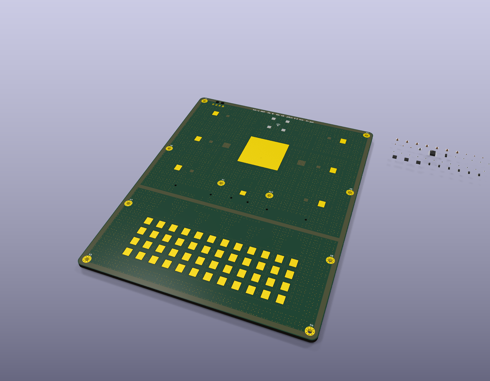
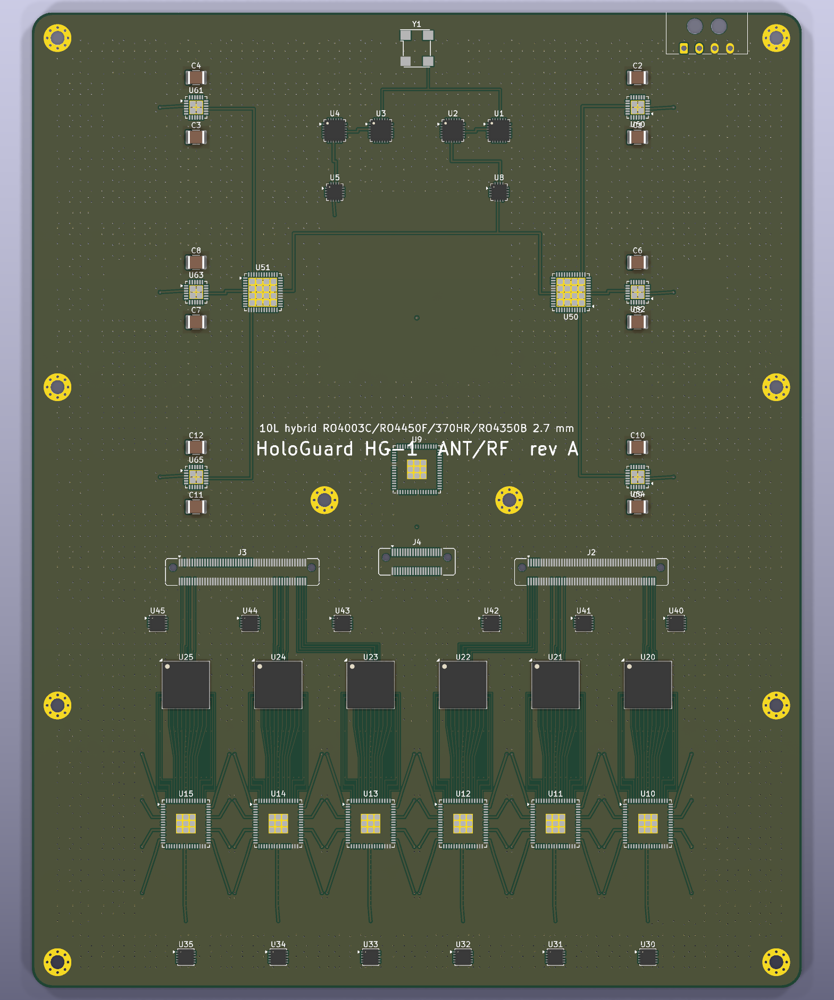
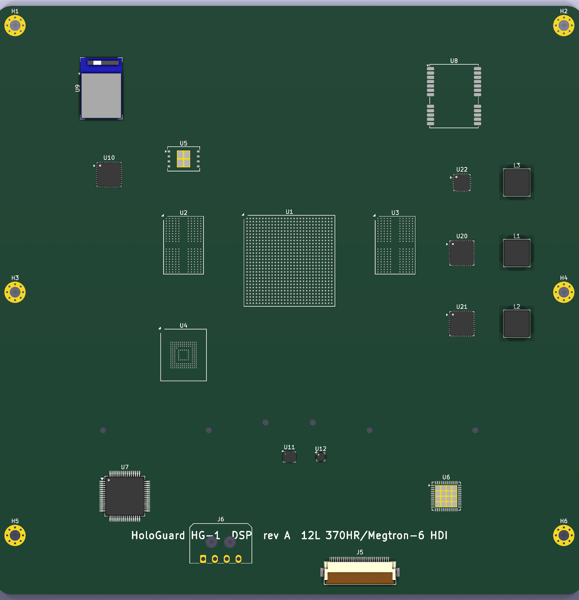

# HoloGuard HG-1: board design

Three boards, generated by [`board/generate_boards.py`](../board/generate_boards.py) (KiCad 10 `pcbnew` API). Every board **passes KiCad DRC with 0 errors and 0 unconnected items** (`board/kicad/*_drc.json`). BOM: [`board/BOM_HG1.csv`](../board/BOM_HG1.csv).

| Board | Size | Stack | Content |
|---|---|---|---|
| **HG1-ANT** antenna / RF | 150 × 190 × 2.72 mm | 10 L hybrid | 54 radiating elements + Remote-ID patch + GNSS patch + cal probe; 6 × HRX-8 RFIC, 6 × AD9083, 6 × GaN PA, 2 × ADAR1000, dual chirp synthesizer, HMC7044, LDOs |
| **HG1-DSP** processing | 150 × 150 × 1.6 mm | 12 L HDI | Versal AI Edge XCVE2302, 2 × LPDDR4, eMMC, QSPI, GbE PHY, STM32G474, GNSS, nRF52840 + nRF7002 Remote-ID, IMU, PoL regulators |
| **HG1-PWR** power / IO | 146 × 30 × 1.6 mm | 6 L 2 oz | 2 × M12 (A-coded power/IO, X-coded Ethernet), TVS, surge stopper, EMI filter, 28 V GaN drain buck-boost, 12 V / 5 V bucks, −5 V gate bias, magnetics, RS-485 |

## HG1-ANT stack-up (antenna side up)

| Layer | Function | Cu (mm) | Dielectric below (mm) |
|---|---|---|---|
| L1 | parasitic patches, fence land, GND ring (mask-free, ENEPIG) | 0.035 | RO4003C 0.813 core + RO4450F 0.203 bond ply = **1.016** (EM-optimised spacer) |
| L2 | driven patches | 0.018 | RO4003C 0.508 |
| L3 | GND with 54 dog-bone coupling slots | 0.018 | RO4003C 0.203 |
| L4 | 50 Ω stripline feeds (w 0.14 mm) | 0.018 | RO4450F 0.102 + RO4003C 0.101 |
| L5 | GND | 0.018 | 370HR 0.100 |
| L6 | +28 V PA / +3V3 RF planes | 0.035 | 370HR 0.100 |
| L7 | GND | 0.035 | 370HR 0.075 |
| L8 | **LO chirp distribution bus** (stripline) | 0.018 | 370HR 0.075 |
| L9 | GND | 0.018 | RO4350B 0.168 |
| L10 | RFICs, ADCs, PAs, synthesizers (component side) | 0.035 | – |

**Total 2.716 mm** including 0.01 mm solder mask each side. The stack-up is defined once, in `hg1_params.STACKS`, which sets `ANT_PCB_T` and the enclosure stack. `generate_boards.py` writes it into each `.kicad_pcb` as a full KiCad physical stack-up (Board Setup → Physical Stackup), so it travels with the PCB file. The DSP board (12 L Megtron-6 1+10+1 HDI, 1.600 mm, ENIG) and PWR board (6 L 2 oz 370HR, 1.600 mm, ENIG) carry theirs the same way.

Earlier revisions quoted 2.1 mm, then 2.3 mm. Neither could hold this layer list: ten copper layers plus the RF cores add up to about 2.7 mm.

The vias are:

- **L1→L5 blind:** the TX/RX isolation fence, plus an **element cavity fence** on every antenna cell boundary at 1.0 mm pitch. That fence suppresses the surface wave that otherwise blinds the array near 60° azimuth scan (see [06_EM_Simulation.md](06_EM_Simulation.md)).
- **L8↔L10 blind:** LO bus.
- **L9↔L10 blind:** EP thermal farms under the RFICs, so no via pierces the antenna.
- **Through vias:** coax-like RF transitions with ground cage vias.
- **Stitching:** 4,438 GND stitching vias, placed only where they keep clear of patches, slots and feeds.

## Routed RF and high-speed paths (complete, DRC-clean)

- **48 RX feeds:** L4 stripline across each coupling slot, then an RF via with a ground via, then a non-crossing L-shaped GCPW fan-out on L10 into the HRX-8 inputs. Each RFIC sits directly behind its 2 × 4 element group.
- **6 TX feeds:** GaN PA output → via → L4 stripline → slot. ADAR1000 → PA drive lines. TX chirp tree from the HMC903 drive amp to both ADAR1000s.
- **IF:** 16 lines per RFIC into its AD9083 in a planar three-group escape (bottom row plus left/right ball columns). 96 lines total.
- **JESD204B:** 24 lanes (4 per ADC) to two Samtec LSHM-150 mezzanines with a planar ordering.
- **LO:** VCO → PLL tune loops, 100 MHz reference tree, and the L8 LO bus feeding all six RFICs.
- **Shield / heat-spreader frame:** wall outlines on `Dwgs.User`. They split TX/synth, the six RFIC cavities and the ADC row, and the CAD frame matches them.

## Status: what is and isn't finished

- **Finished:**
  - schematics for all three boards (see [05_Schematics.md](05_Schematics.md)), with ERC 0 errors and 0 warnings, and schematic↔PCB parity clean;
  - placement of the major parts; all RF, LO, IF, JESD, TX-drive and spotlight paths; power planes, grounding, stitching, mounting;
  - 0 DRC errors.
- **Not yet:**
  - placement of the schematic-only parts, which are staged beside each board: passives, INA186 current-sense amps, extra regulators, drain switch;
  - routing of the remaining ratsnest: 495 / 499 / 197 connections on ANT / DSP / PWR;
  - HDI fan-out of the Versal.
- **Placeholders:** the HRX-8 custom RFIC, the AD9083, ADAR1000 and Versal ball maps, and the other `PROVISIONAL` proxy footprints must be replaced with vendor land patterns.

## Power tree

12–36 V in (M12-A) → TVS SMCJ36CA → LT4363 surge/reverse stopper → CM/DM filter. From there:

- **LT8390 → 28 V / 1.2 A:** GaN drains, behind a high-side switch the MCU sequences.
- **LT8640S → 12 V:** DSP board, then TPS546D24A PoLs (VCCINT and VCC_AIE 0.8 V) plus LT8640S for 1V1/1V8/3V3.
- **LT8640S → 5 V:** RF board, then LT3045 / ADP7159 ultra-low-noise LDOs.
- **LT3462 → −5 V:** GaN gate bias, then the ADAR1000 PA_BIAS DACs. A hardware comparator opens the drain switch on loss.

Firmware sequencing and protection are in [`firmware/mcu`](../firmware/mcu) and tested.
