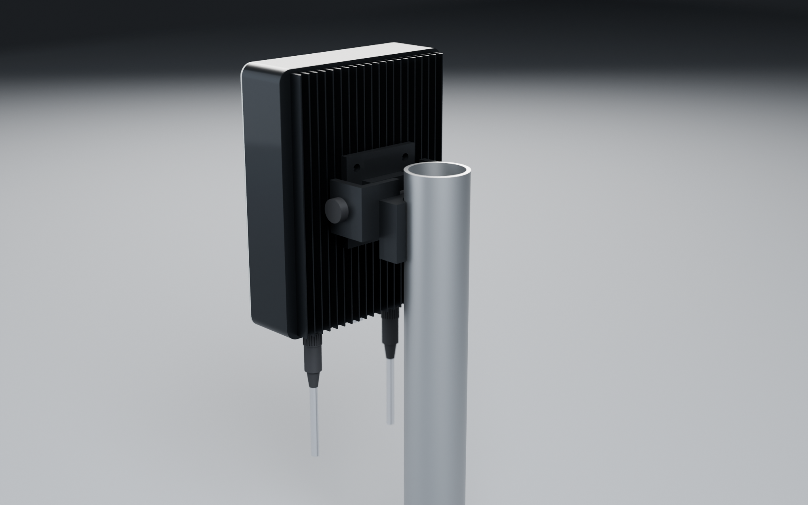
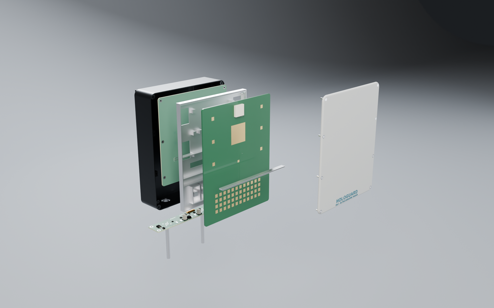
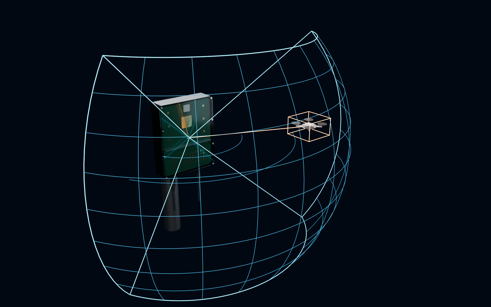

# HoloGuard HG-1: enclosure (FreeCAD) and renders (Blender)

- **Parametric model:** [`mech/build_enclosure.py`](../mech/build_enclosure.py). Run it headless with `freecadcmd`; it reads `hg1_params.py`, so the enclosure always matches the antenna and boards.
- **Outputs** (in `mech/out/`): `HG1_enclosure.FCStd`, `HG1_enclosure.step` (assembly), one STL per part, `mass_report.json`.
- **Renders:** [`mech/render_blender.py`](../mech/render_blender.py) (Blender 5.2, Cycles). It imports the FreeCAD meshes and the KiCad board GLBs; the scene is saved as `render/HG1_scene.blend`.

## Design

| Item | Design |
|---|---|
| Envelope | **163 × 203 × 57 mm** (identical to EchoGuard), portrait, R10 corners |
| Housing | AlSi10Mg (A356-T6) die-cast + CNC, 1.8 mm walls, 2.0 mm back. 20 vertical convection fins (1.2 mm, 7.5 mm pitch, 11 mm tall) and a fin-free mount square. Anodised graphite. |
| Radome | PC/ABS (UV-stabilised, εr ≈ 2.8), 1.0 mm skin over the aperture, 2.4 mm crowned edge, registered 0.8 mm step over a gasket land. 12 × M3 counter-bored stainless screws into wall bosses. |
| Internal stack (from radome) | ~8 mm air gap → ANT board (patches at Z = 48 mm) → isolation fence + absorber up to the radome → cast shield / heat-spreader frame (1 mm web, 1.2 mm cavity walls, thermal pedestals on each PA, RFIC and ADAR1000) → Samtec 10 mm mezzanine → DSP board → hollow ribbed back-wall pedestal + TIM under the Versal |
| I/O | Floor-mounted (drip-safe): M12 A-coded 8-pin (power/IO), M12 X-coded 8-pin (Ethernet), Gore M12 vent, M4 earth stud. The PWR board lies on the floor and the M12s pass through it. |
| Mounting | 4 × M6 bosses on a 50 mm square (back). 6061 tilt bracket: adapter plate, yoke, Ø8 pivot with locking knobs, clamp for a Ø48 mm pole. |
| Sealing / IP67 | radome gasket land, M12 O-rings, vent membrane |
| Mass (CAD) | **1,013 g** radar unit (EchoGuard 1,250 g); bracket 353 g extra |
| Thermal area | 0.221 m² wetted (fins included), about 25 K rise at 46.8 W |

The x-ray render shows the 120° × 80° holographic staring volume. Every beam in this lattice is formed simultaneously from one 50 ms snapshot. The orange track box is a quadcopter with its digital beam.

## Next mechanical steps

1. **Thermal:** CFD/FEA (FloTHERM / Icepak) including solar load, then confirm the TX back-off threshold.
2. **Draft and casting:** add draft angles and parting line, and run casting simulation; fin roots need 0.8 mm fillets.
3. **Gasket:** design the gasket groove and its compression (EPDM, 25 %), and the screw torque spec.
4. **Radome:** RF test of the moulded radome (transmission loss, scan ripple).
