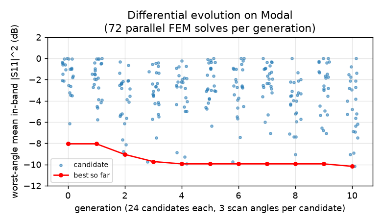
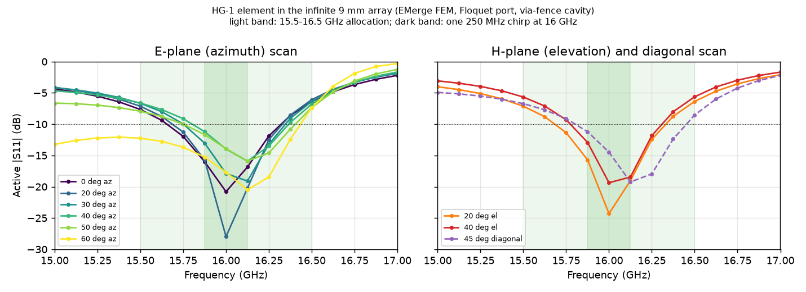
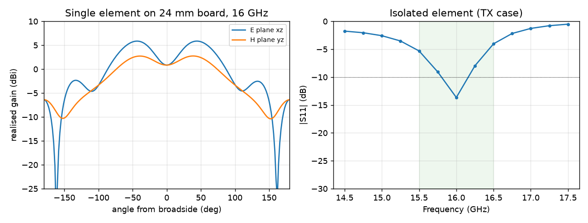

# HoloGuard HG-1: full-wave EM simulation of the radiating element

The aperture-coupled stacked patch was simulated and optimised with **[EMerge](https://github.com/FennisRobert/EMerge)**. EMerge is an open-source Python 3-D finite-element (FEM) solver. It uses a gmsh mesher with second-order Nédélec elements and direct sparse solvers. Small runs used PARDISO on the laptop. Large runs used [Modal](https://modal.com) cloud containers: 72 parallel 8-core containers for the optimiser, and NVIDIA cuDSS on L4 GPUs.

Sources are in [`antenna/em/`](../antenna/em/):

| File | Role |
|---|---|
| `element_em.py` | Parametric model; isolated and periodic modes; writes `results/*.json` |
| `optimize_modal.py` | Differential-evolution optimiser on Modal (one container per candidate) |
| `modal_em.py` | Modal runner (big-CPU / mid-CPU / A100 / L4 containers, numba cache volume) |
| `optimize.py` | Local Nelder–Mead optimiser (first pass) |
| `verify_final.sh` | Local verification of the final element |
| `plot_final.py` | Figures below |

## 1. Models

| | Isolated | Periodic (infinite array) |
|---|---|---|
| Purpose | TX element (the TX elements sit alone, 54 mm from the RX block); radiation pattern | RX lattice: active reflection vs scan |
| Domain | 24 × 24 mm board in a 21 mm-radius air sphere, first-order absorbing boundary | 9 × 9 mm cell, Floquet-periodic side walls; a **Floquet port** 10 mm above L1 matched to the scan angle (k₀ cos θ), so a scanned beam is absorbed exactly |
| Excitation | 50 Ω lumped port on the L4 stripline | same |
| Feed region (L5–L3) | Stripline in a via-fenced corridor plus a pocket round the slot; all cavity modes > 30 GHz | same |
| Antenna layers (L3–L1) | Element via fence modelled as a PEC wall, 0.25 mm inside the cell edge | same |
| Frequency points | 9–17 per run | same |

Stack (z = 0 at L5):

1. L5 GND
2. 0.203 RO4450F / RO4003C
3. L4 stripline
4. 0.203 RO4003C
5. L3 GND with the H-slot
6. 0.508 RO4003C
7. L2 driven patch
8. **1.016** dielectric (built as a 0.813 RO4003C core + 0.203 RO4450F bond ply; modelled as uniform εr 3.55)
9. L1 parasitic patch

Materials: RO4003C εr 3.55, tan δ 0.0027.

## 2. How the design got here

The first-cut dimensions were analytic (closed-form patch and stacked-patch scaling). They were far off; each finding below came from a simulation run:

1. **The analytic element resonated at 13–14 GHz, not 16 GHz.**
   - The 0.813 mm RO4003C superstrate over the driven patch adds about 0.76 mm of fringing length per edge.
   - The dog-bone slot with 1.2–1.4 mm arms resonated by itself at 12.5–13 GHz. So at 16 GHz it was electrically too long and looked like a near-short (|S11| ≈ −0.3 dB).
   - Lengthening the slot made it worse.
2. **A single driven patch tuned to 16 GHz worked but was narrow.** A 3.3–3.5 mm patch with a 2.6 mm slot gave about 0.35 GHz below −10 dB.
3. **The stacked patch on the original 0.813 mm spacer couples too tightly.** The two patch modes split to about 13 and 18 GHz, leaving only a narrow, high-Q mode in band.
4. **The infinite-array model is the right reference for the RX lattice.**
   - The match changes substantially from the isolated case.
   - It also solves 20–30× faster (40–80 s per run on the laptop), which made optimisation practical.
5. **Scan blindness near 60° azimuth.**
   - The best broadside design was well matched to 45° in all planes. At 60° in the E-plane (azimuth) it reflected almost everything: |S11| ≈ −0.5 to −1.2 dB across the band.
   - This is not a grating lobe: d/λ ≤ 0.495 < 0.536. It is the TM₀ surface wave of the patch stack being phase-matched by the scanned array.
   - The board's L1→L5 GND via fence around every element turns each patch into a shallow cavity. That cut the blindness, and the multi-angle optimisation then removed it.
6. **Multi-angle optimisation on Modal.**
   - Method: differential evolution over driven, parasitic, slot, end-arm and stub lengths, plus the parasitic spacer. The spacer snapped to buildable RO4003C stacks: 0.813, 1.016, 1.219 or 1.524 mm.
   - Cost: the worst of the three scan angles (0°, 45° az, 60° az), each scored by mean in-band reflected power over 15.5–16.5 GHz.
   - Scale: 11 generations × 24 candidates × 3 angles = 792 FEM solves, 72 in parallel per generation.
   - Outcome: the optimiser picked the **1.016 mm** spacer, enough coupling for bandwidth with less surface-wave loading than 1.219 or 1.524 mm.



## 3. Final element

| Parameter | Analytic first cut | **EM-optimised** |
|---|---|---|
| Driven patch L × W (L2) | 4.63 × 5.0 mm | **3.21 × 5.0 mm** |
| Parasitic patch L × W (L1) | 5.11 × 5.6 mm | **4.48 × 5.6 mm** |
| Spacer L1–L2 | 0.813 mm | **1.016 mm** (0.813 RO4003C + 0.203 RO4450F) |
| Slot (L3) | 3.3 × 0.30 mm, 1.2 mm arms | **3.02 × 0.30 mm, 2.14 mm arms** |
| Open stub beyond slot | 2.09 mm | **1.50 mm** |
| Element via fence | none | **blind L1→L5 rows on every cell boundary, 1.0 mm pitch** |

These values are now in [`antenna/element_design.json`](../antenna/element_design.json), generated by `array_design.py`. They drive the board copper in `generate_boards.py`.

The 1.016 mm spacer is part of the full ANT physical stack-up in `hg1_params.STACKS`, which is written into the KiCad board. With all ten copper layers the board is **2.716 mm** thick, which also sets `ANT_PCB_T` and the enclosure stack. Modelling the 0.203 mm bond ply as εr 3.55 rather than RO4450F's 3.52 shifts the resonance by about 0.01 %, far below the mesh noise.

### Active reflection vs scan (infinite array, local verification run)

The verification run uses a finer frequency grid (17 points over 15–17 GHz) and mesh resolution 0.18:

| Scan | −10 dB band | VSWR 2 band | \|S11\| at 15.5 / 16.0 / 16.5 GHz | Mean in band |
|---|---|---|---|---|
| broadside | 15.66–16.32 GHz | 15.64–16.33 GHz | −7.6 / −20.8 / −6.4 dB | −11.1 dB |
| 20° az | 15.70–16.32 | 15.67–16.33 | −7.1 / −28.0 / −6.1 | −10.9 |
| 30° az | 15.76–16.34 | 15.73–16.36 | −6.7 / −17.9 / −6.4 | −10.5 |
| 40° az | 15.81–16.36 | 15.78–16.38 | −6.6 / −14.0 / −6.9 | −10.1 |
| 50° az | 15.75–16.40 | 15.71–16.41 | −7.9 / −13.9 / −7.4 | −10.9 |
| 60° az | < 15.0–16.29 | < 15.0–16.29 | −12.2 / −17.7 / −7.4 | −8.8 |
| 20° el | 15.69–16.32 | 15.67–16.34 | −7.1 / −24.3 / −6.4 | −11.0 |
| 40° el | 15.78–16.30 | 15.76–16.32 | −5.6 / −19.4 / −5.7 | −9.6 |
| 45° diagonal | 15.81–16.44 | 15.78–16.46 | −6.7 / −14.5 / −8.6 | −10.9 |



**What this means for the radar:**

- The waveform is a **250 MHz** chirp (`hg1_params.BW_MHZ`); 15.5–16.5 GHz is the band it can be tuned across.
- At every scan angle to 60° az / 40° el, the element stays below −10 dB over **at least 0.52 GHz centred about 16.0–16.1 GHz**. That covers a chirp placed anywhere in about 15.7–16.3 GHz with less than 0.5 dB mismatch loss.
- At the 15.5 and 16.5 GHz allocation edges the active match is −5.6 to −8.6 dB, which is 0.6–1.3 dB mismatch loss. That is acceptable for occasional channel-agile use at the band edges, but it does not meet the original "VSWR < 2 over 15.1–16.9 GHz" target. This is a thin stack (2.06 mm of dielectric above L3 at εr 3.55); a wider band would need a thicker or lower-εr spacer, or a third resonator, at more surface-wave risk.

### Isolated element (TX case) and pattern



**Match (TX case):**

- On its own, the element is matched from **15.79 to 16.17 GHz**, with a best of −13.7 dB at 16.0 GHz and VSWR 2 over about 15.78–16.18 GHz.
- That is narrower than in the array, because the dimensions were optimised for the array environment.
- It covers a 250 MHz chirp centred at about 15.9–16.05 GHz.
- The six TX elements are physically separate from the RX block, so they can be given their own dimensions. A TX-only re-tune is a cheap follow-up if channel agility across the whole allocation is needed.

**Pattern (not yet trusted):**

- At 16 GHz the computed realised gain is **0.8 dBi at broadside**, with E-plane peaks of 5.9 dBi at ±45° and H-plane peaks of 2.7 dBi at ±38°. The −3 dB width is about ±72° / ±76°, and the back lobe is −6.4 dBi.
- A broadside **dip** is not what a patch does. Every isolated run showed it, with and without the via fence.
- So it most likely comes from the model, not the element:
  - the 24 mm (1.3 λ) board puts strong edge diffraction close to the element;
  - the first-order absorbing sphere is only about 4 mm from the board corners;
  - or the near-to-far-field transform is at fault. It has not yet been validated here on a canonical antenna.
- These pattern numbers are therefore **not** used in the design. The array analysis keeps the analytic embedded pattern (E cos^0.9, H cos^1.3).
- The active-impedance results above are unaffected, because they come from the port solution, not the far-field transform.
- Open item: validate the far-field step on a reference dipole or patch, then run a larger board with a PML or a finite array.

## 4. Validation and limits

- **Solver cross-check:** the same job on Modal cuDSS (GPU) and local PARDISO (CPU) agrees to about 1 × 10⁻³ in complex S11.
- **Mesh noise:**
  - At the optimiser's coarse mesh (resolution 0.22), re-meshing an identical geometry with dimensions rounded in the 3rd decimal moves the in-band mean by up to about 0.8 dB. The optimiser therefore ran at 0.18 on Modal, and the final verification also uses 0.18.
  - Differences smaller than about 0.5 dB between designs are not significant.
- **Fitted-curve artefacts:** fitted |S11| curves (rational fit between solved points) can show unphysically deep notches, or values above 0 dB (60° az). The tables and figures above use **raw solved points** for worst-case values.
- **Not modelled yet:**
  - the via fence as discrete posts: it is modelled as a solid PEC wall, inset 0.25 mm per cell;
  - finite-array edge elements, the 1.0 mm PC/ABS radome about 8 mm above, copper roughness, and etch tolerance;
  - TX↔RX coupling;
  - the isolated-element far-field pattern, which needs the far-field validation in §3.

  A finite-array embedded-element run and an independent solver (openEMS / HFSS / CST) cross-check are recommended before fabrication.

## 5. Reproduce

```bash
.venv/Scripts/python antenna/em/element_em.py periodic --theta 60 --phi 0 --nf 17 --f1 15 --f2 17 --res 0.18 --tag _final
```

```bash
sh antenna/em/verify_final.sh
```

```bash
.venv/Scripts/python antenna/em/optimize_modal.py --kind mid --popsize 4 --maxiter 10 --nf 9 --res 0.18 --scan 45:0 60:0
```

```bash
.venv/Scripts/python antenna/em/plot_final.py
```

The element defaults (`GEOM` in `element_em.py`) are read from `antenna/element_design.json`, so running without `--set` uses the final design. The Modal runs need `modal token new` once, and the cuDSS image is built automatically.
